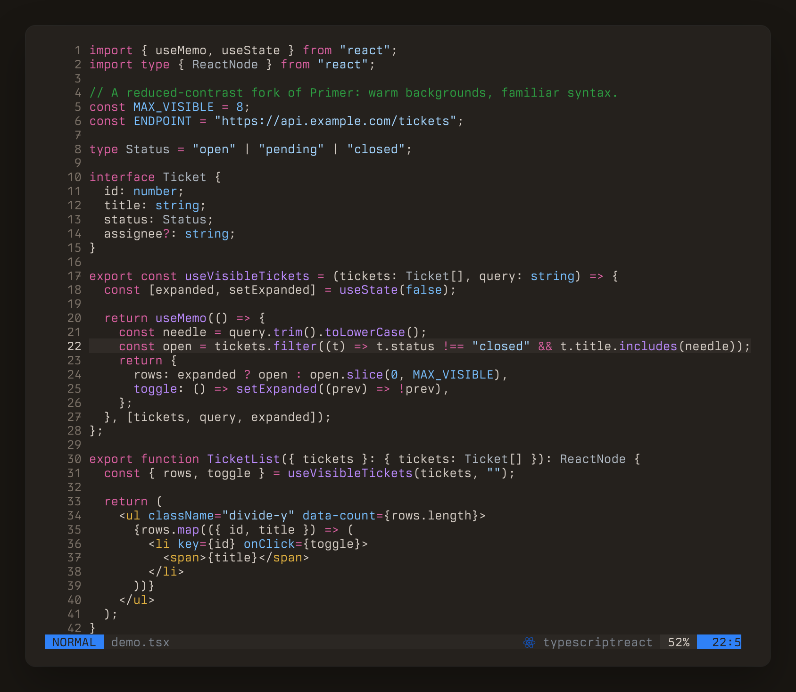
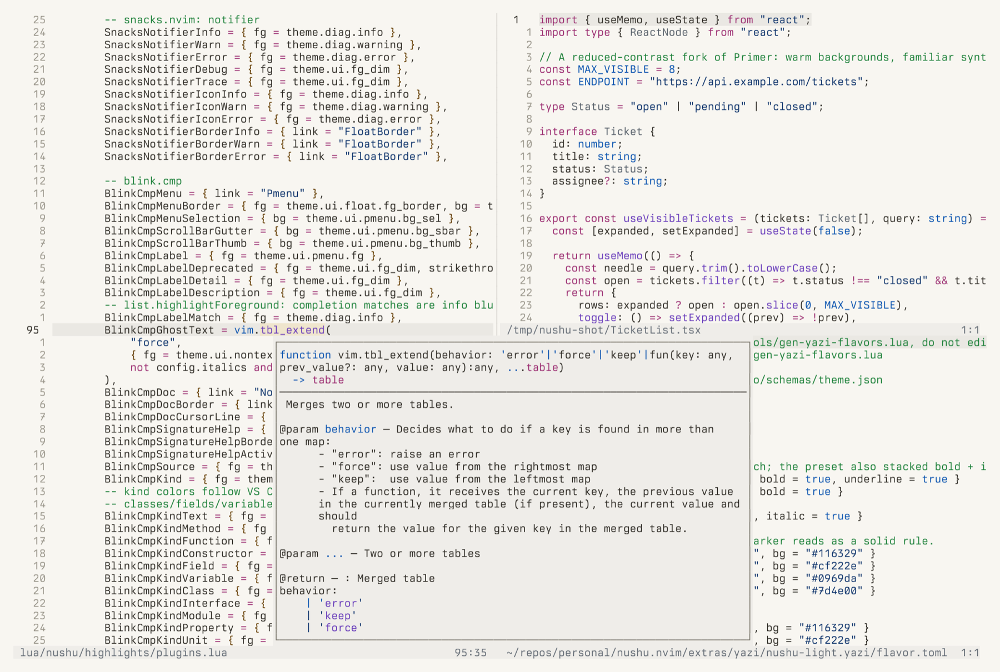
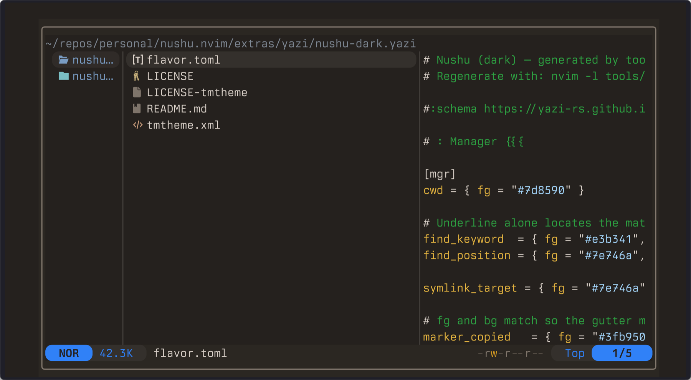

# nushu.nvim

A Neovim port of the **Nushu** theme — a reduced-contrast fork of GitHub's
default themes that keeps the familiar Primer syntax palette on warm,
comfortable backgrounds. Dark and light variants included.

**Dark**



**Light**



## Requirements

- Neovim ≥ 0.9
- `termguicolors` (set automatically on load)

## Installation

With [lazy.nvim](https://github.com/folke/lazy.nvim):

```lua
{
    "h-jennings/nushu.nvim",
    lazy = false,
    priority = 1000,
    config = function()
        require("nushu").setup({
            -- your options here
        })
        vim.cmd([[colorscheme nushu]])
    end,
}
```

## Usage

```vim
" Follow 'background' (dark -> Nushu Dark, light -> Nushu Light)
colorscheme nushu

" Pin a variant, ignoring 'background'
colorscheme nushu-dark
colorscheme nushu-light
```

With `colorscheme nushu`, changing `:set background=light` (e.g. via
auto-dark-mode.nvim) re-applies the matching variant automatically.

### Pinning one variant

A pinned variant holds regardless of `'background'`, so it survives anything
that toggles it on a timer. Either entry point works:

```vim
colorscheme nushu-dark
```

```lua
require("nushu").setup({ theme = "dark" })
```

Going back to `:colorscheme nushu` clears the pin and resumes following
`'background'`.

`g:colors_name` reports the entry point in use — `nushu` when following
`'background'`, or `nushu-dark`/`nushu-light` when pinned. That is what allows a
pin to survive: Neovim re-sources `g:colors_name` on every `'background'` change,
so the pinned variant has to name its own file. Anything of yours that keys off
`g:colors_name` should match on the `nushu` prefix rather than compare exactly.

## Configuration

Defaults shown. `setup()` may be called before or after `:colorscheme`.

```lua
require("nushu").setup({
    bold = true,           -- gate all bold usage (titles, headings)
    italics = true,        -- gate all italic usage (markup emphasis, links, ghost text)
    undercurl = true,      -- undercurl for diagnostics/spell (underline when false)
    transparent = false,   -- no background color
    dimInactive = false,   -- dim non-current windows
    terminalColors = true, -- set vim.g.terminal_color_*
    commentStyle = {},     -- extra styles, e.g. { italic = true }
    functionStyle = {},
    keywordStyle = {},
    statementStyle = {},
    typeStyle = {},
    colors = { palette = {}, theme = { dark = {}, light = {}, all = {} } },
    overrides = function(colors) -- add/modify highlights
        return {}
    end,
    background = { dark = "dark", light = "light" }, -- 'background' -> variant map
    theme = "dark",        -- used when background mapping is disabled
})
```

Nushu itself uses no comment or keyword italics — the `italics` flag only
affects markup emphasis, links, and ghost text.

### Overriding colors

Two layers are overridable: the raw **palette** (named hex values) and the
per-variant semantic **theme** (`ui`, `syn`, `diag`, `diff`, `vcs`, `term`):

```lua
require("nushu").setup({
    colors = {
        palette = { darkBg = "#201c19" },
        theme = {
            dark = { ui = { float = { bg = "#2b2723" } } },
            all = { ui = { bg_gutter = "NONE" } },
        },
    },
})
```

### Overriding highlight groups

`overrides` receives the resolved colors for the active variant, so overrides
survive dark/light switches:

```lua
require("nushu").setup({
    overrides = function(colors)
        local theme = colors.theme
        return {
            NormalFloat = { bg = theme.ui.bg },
            ["@string"] = { fg = theme.syn.string, italic = true },
        }
    end,
})
```

## Lualine

A matching lualine theme ships with the plugin and is picked up by
`theme = "auto"`. Mode colors mirror the Nushu Zed theme's vim mode indicator
(normal blue, insert green, visual purple, replace orange, command pink). Set
`vim.g.nushu_lualine_bold = true` for bold mode sections.

## Yazi



Two matching [yazi](https://github.com/sxyazi/yazi) flavors ship in
[`extras/yazi/`](./extras/yazi), for use standalone or through
[yazi.nvim](https://github.com/mikavilpas/yazi.nvim). Copy or symlink both into
your yazi config directory and select them:

```toml
# ~/.config/yazi/theme.toml
[flavor]
dark  = "nushu-dark"
light = "nushu-light"
```

Most of yazi needs no help: its default theme names colors as ANSI slots, which
already resolve through `vim.g.terminal_color_*` inside a Neovim terminal buffer.
The flavors exist for the parts that don't —

- **Icons.** yazi hardcodes 725 Material Design colors in `[icon]`, at a median
  saturation of 0.76. They're remapped by hue onto nine tones drawn from the
  nushu palette and pinned to one saturation and lightness, so filetypes stay
  distinguishable without the rainbow.
- **Borders.** yazi's `gray` is ANSI 7, which lands on nushu's terminal *white* —
  brighter than the float border Neovim draws around yazi, so the inner column
  dividers outshouted the frame around them. They now use `ui.border`.
- **Hover.** The preset uses `reversed = true`, which swaps fg and bg and so
  discards the file's own color. The flavors tint the row background instead,
  the way `CursorLine` does.
- **Previews.** Each flavor ships a `tmtheme.xml` built from the same syntax
  mapping as the editor highlights, so previewed files use nushu's palette rather
  than syntect's default theme. yazi tokenizes with TextMate scopes rather than
  Tree-sitter, so a preview matches in color without matching an open buffer
  token for token.

Both flavors are generated — run `nvim -l tools/gen-yazi-flavors.lua` after
changing the palette, and see [`tools/vendor/README.md`](./tools/vendor/README.md)
for refreshing the icon set after a yazi upgrade. Edit `theme.toml`, not the
flavor: yazi merges your theme over the flavor and yours wins.

Note that yazi picks dark or light at launch from the *terminal's* reported
appearance, not Neovim's `background`, so a variant switch lands on the next
open rather than in a window already showing.

## Attribution

- [wheredoesyourmindgo/nushu-vscode-theme](https://github.com/wheredoesyourmindgo/nushu-vscode-theme)
  — the original Nushu theme this port is derived from
- [GitHub Primer](https://primer.style/) — the syntax color palette
- [h-jennings/nushu-zed-theme](https://github.com/h-jennings/nushu-zed-theme)
  — the Zed port used as the color source of truth
- [kanso.nvim](https://github.com/webhooked/kanso.nvim) /
  [kanagawa.nvim](https://github.com/rebelot/kanagawa.nvim) (MIT) — the
  architectural basis for this plugin's structure

## License

MIT — see [LICENSE](./LICENSE).
